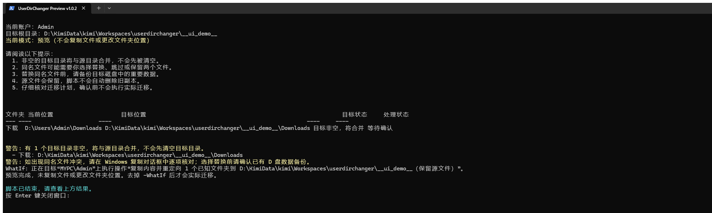

# Windows 用户文件夹迁移工具

**当前版本：v1.0.2**

将当前 Windows 用户的桌面、文档、下载、音乐、图片和视频迁移到 D 盘，并通过 Windows 系统接口更新默认位置。适合重装 Windows 11 后整理用户目录，也支持与 D 盘已有文件夹合并。

## 界面预览



图中使用临时目标目录演示“目标非空，将合并”。预览模式不会复制文件或更改文件夹位置。

## 主要特点

- 中文操作界面，迁移前集中显示源路径、目标路径和处理方式。
- 使用 Windows Known Folder API，不直接改写已知文件夹注册表值。
- 默认处理桌面、文档、下载、音乐、图片和视频。
- 支持合并已有的 D 盘目录，不会先清空目标目录。
- 保留源文件，脚本不会自动删除 C 盘旧副本。
- 检查目标磁盘、NTFS、可用空间、OneDrive、异常路径和源目录权限。
- 支持预览、取消操作、迁移日志和原始路径清单。

## 使用前请确认

1. **备份 C 盘和 D 盘的重要数据。** 合并时如果选择替换同名文件，D 盘原有版本可能被覆盖。
2. 目标磁盘必须是可用的本地固定 NTFS 磁盘，并有足够空间。
3. 关闭正在编辑文档、下载文件或播放媒体的软件。
4. 如果桌面、文档或图片已由 OneDrive 备份，请先在 OneDrive 设置中停止对应文件夹的备份，确认文件完整后再运行。
5. 在需要迁移的 Windows 账户下运行。其他账户需要分别登录后操作。

## 使用方式一：独立 EXE（推荐普通用户）

### 获取和启动

项目中的 EXE 位于 `release\UserDirChanger.exe`。从 GitHub Release 下载时，普通用户只需下载 `UserDirChanger.exe`，不需要同时复制 PS1 或 CMD 文件。

EXE 内嵌迁移脚本，运行时释放到当前用户临时目录，正常结束后自动清理。它是中文文字界面，不是图形化安装程序；运行时需要 Windows 11 自带的 Windows PowerShell 5.1，不需要安装 .NET SDK，也不需要修改系统全局执行策略。

双击 `UserDirChanger.exe` 即可启动。请以需要迁移的 Windows 账户运行，不要使用其他账户的管理员凭据。

当前 EXE 未进行代码签名，Windows 可能显示“未知发布者”或 SmartScreen 提示。请只从可信来源获取，并在运行前核对项目源码。

### 仅查看预览

在 EXE 所在目录打开 CMD，运行：

```cmd
UserDirChanger.exe --preview
```

预览会执行路径、权限、磁盘和目标状态检查，但不会复制文件、修改注册表或更改已知文件夹位置。

也可以传入目标目录和文件夹列表：

```cmd
UserDirChanger.exe --preview -DestinationRoot "D:\MyData" -Folders Documents,Downloads
```

## 使用方式二：直接运行源代码

适合希望查看、修改或不使用 EXE 的用户。此方式不需要 `UserDirChanger.exe`。

### 准备文件

将以下三个文件放在同一目录，并保持文件名不变：

```text
Run-UserFolderMigration.cmd
Start-UserFolderMigration.ps1
Move-UserFolders.ps1
```

### 启动和预览

双击 `Run-UserFolderMigration.cmd`，或右键选择“打开”，进入实际迁移确认流程。

只查看预览时，在这三个文件所在目录打开 CMD，运行：

```cmd
Run-UserFolderMigration.cmd --preview
```

也可以在 PowerShell 中直接调用中文启动脚本：

```powershell
powershell.exe -NoProfile -ExecutionPolicy Bypass -File ".\Start-UserFolderMigration.ps1" -Preview
```

只预览文档和下载，并自定义目标根目录：

```powershell
powershell.exe -NoProfile -ExecutionPolicy Bypass -File ".\Start-UserFolderMigration.ps1" -Preview -DestinationRoot "D:\MyData" -Folders Documents,Downloads
```

去掉 `-Preview` 即进入实际迁移确认流程。

## 两种方式的共同操作

### 核对迁移计划

默认目标根目录为：

```text
D:\Users\你的用户名
```

目标状态含义：

| 显示内容 | 含义 |
| --- | --- |
| 目标不存在，将新建 | 脚本将创建目标文件夹 |
| 目标为空 | 可以直接使用目标文件夹 |
| 目标非空，将合并 | 源内容会复制到已有目录，不会先清空目录 |
| 已在目标位置 | 无需重复处理 |

### 确认或取消

核对后，PowerShell 会要求确认：

- `Y`（Yes）：同意本次迁移。
- `A`（Yes to All）：同意后续同类确认；本脚本通常只有一次总确认，因此与 `Y` 基本相同。
- `N`（No）：取消，不复制文件或更改文件夹位置。

这些选项不表示“替换所有同名文件”。文件冲突由后续的 Windows 复制对话框单独处理。

### 完成并检查

迁移完成后：

1. 注销并重新登录 Windows。
2. 检查桌面、文档、下载等位置能否正常打开。
3. 检查常用软件的保存位置和个人文件。
4. 确认新位置文件完整并有备份后，再自行决定是否清理旧的 C 盘副本。

## 合并规则

- 非空目标目录会与源目录合并，不会被脚本预先清空。
- 源文件会保留，不会因为迁移成功而自动删除。
- 同名文件可能需要你选择替换、跳过或保留两个文件。
- 选择替换前，请确认目标磁盘中的重要文件已有备份。
- 脚本验证系统返回的新路径和目标目录是否存在，**不进行逐文件哈希校验**。
- 如果在复制对话框中选择跳过，某些源文件可能只保留在原位置，请根据日志和源目录自行核对。

## 从源码构建 EXE（可选）

仓库保留完整源码，便于审查和修改。构建时需要 Windows 自带的 .NET Framework C# 编译器，不需要下载第三方打包工具：

```powershell
powershell.exe -NoProfile -ExecutionPolicy Bypass -File ".\Build-UserDirChangerExe.ps1"
```

构建完成后会在 `release` 文件夹生成 `UserDirChanger.exe`。EXE 内嵌两个 PS1 文件，运行时会释放到临时目录，再调用系统 PowerShell；它没有改变迁移逻辑，也不是完全脱离 Windows 组件的便携式运行时。

普通用户运行 EXE 不需要安装编译器或 .NET SDK。发布前应对最终生成的 EXE 重新进行预览和取消测试。

## 日志与恢复信息

实际迁移确认后，日志保存在：

```text
%LOCALAPPDATA%\KnownFolderMigration\时间戳\
```

主要包括：

| 文件 | 用途 |
| --- | --- |
| `migration.log` | 查看处理过程和失败原因 |
| `migration-plan.json` | 查看原始路径、目标路径和处理状态 |
| `User-Shell-Folders-before.reg` | 迁移前的用户文件夹配置备份 |

脚本不提供一键回滚。注册表备份和路径清单用于排查与恢复参考，不建议在不清楚影响时直接导入旧配置。

## 适用范围与限制

- 仅迁移当前账户的六类已知文件夹，不迁移整个 `C:\Users`。
- `%USERPROFILE%`、`AppData` 和其他配置目录保持原位置，这是有意保留的安全边界。
- 使用 Windows 标准接口获取文件夹位置的软件通常可以识别新路径；硬编码旧路径或具有独立保存设置的软件仍需单独调整。
- OneDrive、企业组策略或第三方同步软件可能接管或覆盖文件夹设置。
- 目标目录合并不等于备份，D 盘与 C 盘位于同一物理磁盘时尤其如此。
- 无法承诺所有软件永远没有兼容性问题。首次使用建议先在测试账户中验证。

## 文件说明

| 文件 | 作用 |
| --- | --- |
| `release/UserDirChanger.exe` | 普通用户的单文件启动入口，内嵌两个 PS1 脚本 |
| `Run-UserFolderMigration.cmd` | 源码启动入口，只负责调用 PowerShell |
| `Start-UserFolderMigration.ps1` | 中文界面、版本信息和结束暂停 |
| `Move-UserFolders.ps1` | 预检、复制、重定向、日志及错误处理 |
| `Build-UserDirChangerExe.ps1` | 从源码重新构建 EXE |
| `tools/UserDirChangerLauncher.cs` | EXE 启动器源码 |
| `CHANGELOG.md` | 版本更新记录 |

## 问题反馈

提交问题时，请附上 Windows 版本、操作步骤、源路径与目标路径类型，以及日志中的错误信息。公开日志前请删除用户名、文件名等个人隐私。

版本记录见 [CHANGELOG.md](CHANGELOG.md)。
