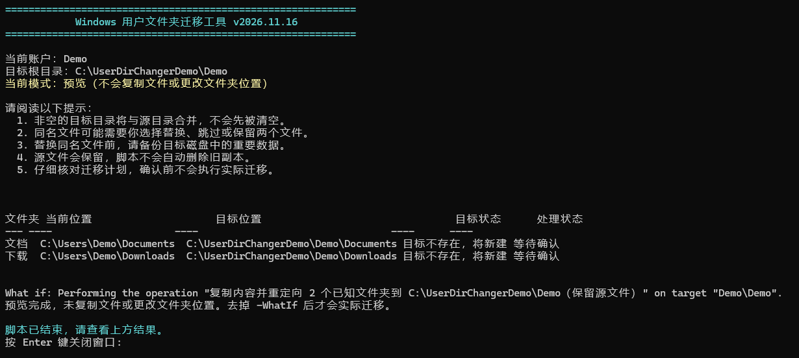

# Windows 用户文件夹迁移工具

**当前版本：v2026.11.16**

UserDirChanger 将当前 Windows 账户的桌面、文档、下载、音乐、图片和视频复制到另一个本地固定 NTFS 磁盘，并通过 Windows Known Folder API 更新这些文件夹的默认位置。

这是一个中文命令行工具，不是图形化安装程序。它只处理上述六类已知文件夹，不迁移整个用户配置文件、`AppData` 或其他账户的数据。

> **迁移实际是“复制并重定向”，不是移动后删除源文件。** 成功后原位置的文件仍会保留，需要确认新位置文件完整并另有备份后，再自行清理旧副本。

## 软件界面

预览模式会列出源路径、目标路径和处理状态；截图中的账户及路径均为脱敏示例。



## 使用前必读

1. **备份源磁盘和目标磁盘中的重要数据。** 合并目录时，如果在 Windows 复制对话框中选择替换，同名目标文件可能被覆盖。
2. 在需要迁移的 Windows 账户下登录并运行，不要使用其他管理员账户的凭据。其他账户需要分别处理。
3. 目标必须是已就绪的本地固定 NTFS 磁盘，并有足够可用空间；不支持 UNC 网络路径或可移动磁盘。
4. 关闭正在编辑文档、下载文件或播放媒体的软件。
5. 如果相关文件夹由 OneDrive 备份，请先在 OneDrive 设置中停止备份，确认文件夹路径已恢复且文件完整，再运行本工具。
6. 首次使用建议先预览，并优先在测试账户中验证常用软件的兼容性。

运行环境为 Windows 11 和系统自带的 Windows PowerShell 5.1。普通用户运行 EXE 不需要安装 .NET SDK，也不需要修改系统全局 PowerShell 执行策略。

## 使用 EXE

单独复制或下载 `UserDirChanger.exe` 即可，不需要同时携带 PS1 或 CMD 文件。

EXE 内嵌两个 PowerShell 脚本，运行时将其释放到当前用户临时目录，调用系统 PowerShell，结束后尽力清理临时文件。当前 EXE 未进行代码签名，Windows 可能显示“未知发布者”或 SmartScreen 提示，请只从可信来源获取。

### 预览迁移计划

在 EXE 所在目录打开 CMD，运行：

```cmd
UserDirChanger.exe --preview
```

预览会读取当前已知文件夹路径，检查目标磁盘、可用空间、OneDrive、异常路径、目标状态和源目录读取权限，但不会复制文件、修改注册表或更改文件夹位置，也不会创建本次实际迁移的日志。目录较大时，空间估算可能需要一些时间。

自定义目标根目录并只预览文档和下载：

```cmd
UserDirChanger.exe --preview -DestinationRoot "D:\MyData" -Folders Documents,Downloads
```

### 实际迁移

双击 `UserDirChanger.exe`，或去掉命令中的 `--preview`。程序会先显示迁移计划，核对后仍需在 PowerShell 提示中确认，不会在双击时立刻复制或重定向。

## 直接运行源代码

直接运行源代码时不需要 EXE。将以下三个文件放在同一目录，并保持文件名不变：

```text
Run-UserFolderMigration.cmd
Start-UserFolderMigration.ps1
Move-UserFolders.ps1
```

- 双击 `Run-UserFolderMigration.cmd`：进入实际迁移的确认流程。
- 运行 `Run-UserFolderMigration.cmd --preview`：只查看预览。

也可以在 PowerShell 中调用中文启动脚本：

```powershell
powershell.exe -NoProfile -ExecutionPolicy Bypass -File ".\Start-UserFolderMigration.ps1" -Preview
```

自定义目标和文件夹：

```powershell
powershell.exe -NoProfile -ExecutionPolicy Bypass -File ".\Start-UserFolderMigration.ps1" -Preview -DestinationRoot "D:\MyData" -Folders Documents,Downloads
```

去掉 `-Preview` 即进入实际迁移确认流程。CMD 入口只提供基本启动和预览；需要传入目标或文件夹参数时，请使用上述 PowerShell 命令。

### 直接调用迁移引擎

`Move-UserFolders.ps1` 也可以独立调用，并使用 `-WhatIf` 预览：

```powershell
powershell.exe -NoProfile -ExecutionPolicy Bypass -File ".\Move-UserFolders.ps1" -WhatIf -DestinationRoot "D:\MyData" -Folders Documents,Downloads
```

**合并规则与中文入口不同：** EXE 和 `Start-UserFolderMigration.ps1` 总是允许合并非空目标；直接调用引擎时，非空目标默认会被拒绝，只有明确确认风险后才添加 `-AllowTargetMerge`。

## 文件夹与目标路径

默认目标根目录为：

```text
D:\Users\当前用户名
```

各文件夹使用英文参数名，目标子目录也使用英文名：

| 参数值 | 文件夹 | 默认目标子目录 |
| --- | --- | --- |
| `Desktop` | 桌面 | `Desktop` |
| `Documents` | 文档 | `Documents` |
| `Downloads` | 下载 | `Downloads` |
| `Music` | 音乐 | `Music` |
| `Pictures` | 图片 | `Pictures` |
| `Videos` | 视频 | `Videos` |

`-Folders` 接受逗号分隔的一个或多个参数值；未指定时处理全部六类。迁移计划中的目标状态含义如下：

| 显示内容 | 含义 |
| --- | --- |
| 目标不存在，将新建 | 确认后创建目标目录 |
| 目标为空 | 可以直接使用目标目录 |
| 目标非空，将合并 | 源内容复制到已有目录，不会先清空目标 |
| 已在目标位置 | 无需重复处理 |

## 确认、复制与合并

- 核对源路径、目标路径和目标状态后，按 PowerShell 提示确认；选择 `N` 可取消，不复制文件或更改文件夹位置。
- 确认迁移只表示同意本次复制和重定向，**不表示同意替换所有同名文件**。同名文件冲突由后续的 Windows 复制对话框单独处理。
- 目标目录不会被预先清空。选择替换、跳过或保留两个文件前，应核对内容并确保已有备份。
- 源文件会保留。若复制时选择跳过，部分文件可能只存在于原位置，需要自行核对。
- 工具会验证系统返回的新路径与目标一致，并检查目标目录存在，**不会逐文件计算哈希或证明所有内容均已复制**。
- 如果某项处理失败，流程会停止；此前已经完成的重定向不会自动回滚，源文件不会被脚本删除。

完成后注销并重新登录 Windows，检查六类文件夹、常用软件保存位置及文件完整性。确认新位置可用且另有备份后，再自行决定是否清理旧副本。

## 日志与恢复信息

有待处理项目并确认实际迁移后，工具会在当前用户的本地应用数据目录中创建独立的运行目录，保存处理日志、路径清单和迁移前的当前用户文件夹配置备份。

工具不提供一键回滚。这些资料仅供排查与恢复参考；不了解影响时，不要直接导入旧注册表配置。公开反馈日志前，请删除用户名、文件名等个人隐私。

## 从源码构建 EXE

构建使用 Windows 自带的 .NET Framework C# 编译器，不下载第三方打包工具：

```powershell
powershell.exe -NoProfile -ExecutionPolicy Bypass -File ".\Build-UserDirChangerExe.ps1"
```

生成的 EXE 会嵌入当前的 `Start-UserFolderMigration.ps1` 和 `Move-UserFolders.ps1`。构建完成后，按脚本输出的路径获取文件。修改脚本或版本号后必须重新构建，已有 EXE 不会自动包含新源码。

编辑含中文的 PS1 文件时必须保留 **UTF-8 BOM**。Windows PowerShell 5.1 会把无 BOM 的 UTF-8 脚本按本地 ANSI 编码读取，可能导致中文乱码或脚本解析失败。

## 适用范围与限制

- 仅处理当前账户的六类已知文件夹；`%USERPROFILE%`、`AppData` 和其他配置目录保持原位置。
- 使用 Windows 标准接口获取文件夹位置的软件通常可以识别新路径；硬编码旧路径或有独立保存设置的软件仍需单独调整。
- OneDrive、企业组策略或第三方同步软件可能接管或覆盖文件夹设置。
- 目标目录合并不等于备份；源磁盘和目标磁盘位于同一物理磁盘时，也不能防范磁盘故障。
- 可用空间检查是复制前的估算，不能替代备份、复制过程核对和完成后的文件检查。

## 文件说明

| 文件 | 作用 |
| --- | --- |
| `Run-UserFolderMigration.cmd` | 源码基本启动与预览入口 |
| `Start-UserFolderMigration.ps1` | 中文界面、参数处理、版本显示和结束暂停 |
| `Move-UserFolders.ps1` | 预检、复制、重定向、日志和错误处理 |
| `Build-UserDirChangerExe.ps1` | 使用系统编译器重建 EXE |
| `tools/UserDirChangerLauncher.cs` | EXE 启动器、资源释放和参数转发源码 |

## 问题反馈

提交问题时，请说明 Windows 版本、使用的入口、操作步骤、源路径与目标路径的类型，以及日志中的错误信息。公开路径、清单、截图或日志前，请先删除个人用户名、真实文件名和其他隐私内容。
